# Pengo

An unofficial browser remake of the 1982 arcade game, with new graphics. Push blocks of ice, crush the Sno-Bees and line up the diamonds on a frozen lake under the northern lights.

**▶ Play: https://wigy.github.io/pengo/**

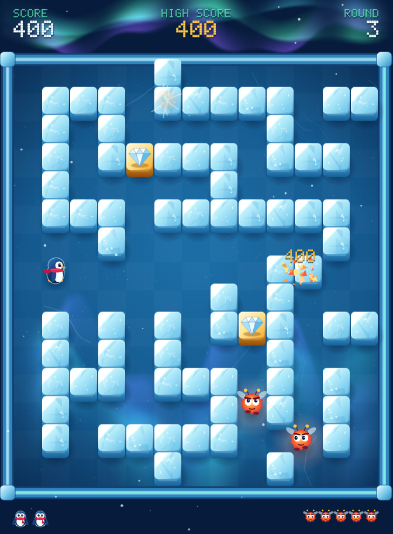

| | | |
|---|---|---|
| 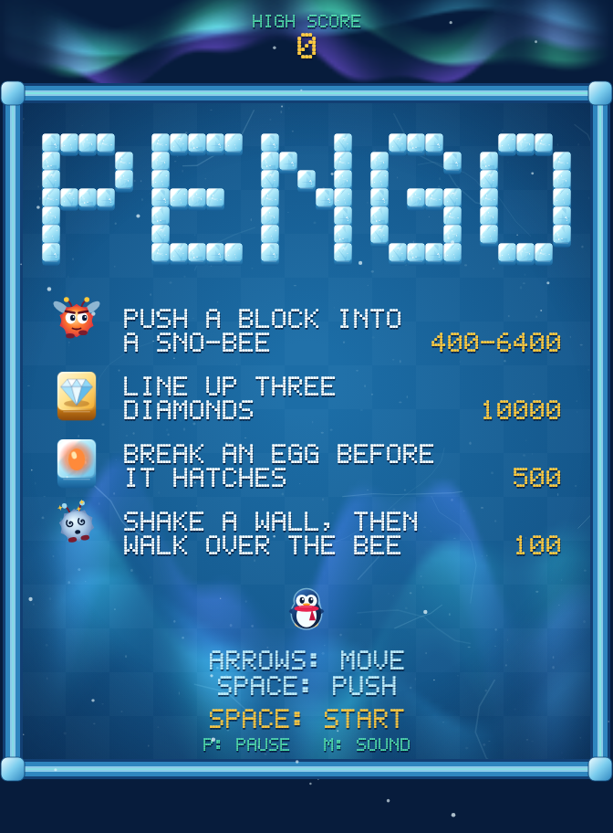 | 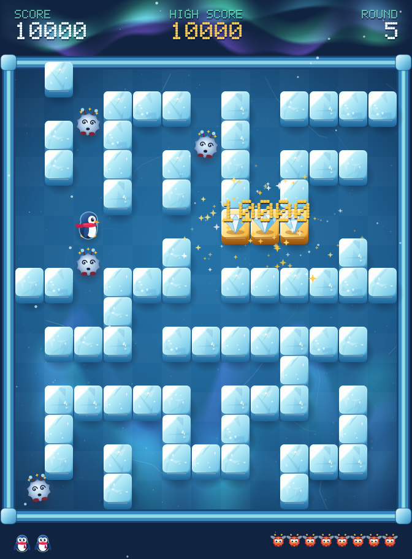 | 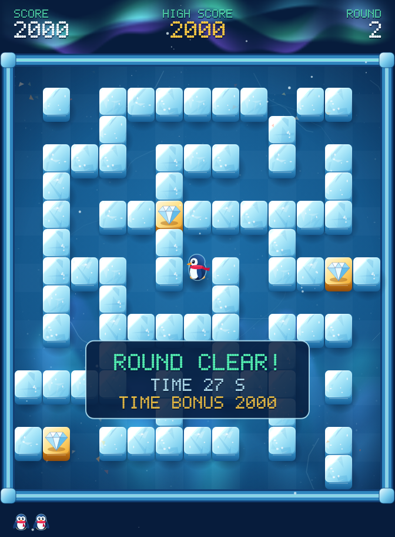 |

## Running the game

Play it [online](https://wigy.github.io/pengo/), or download the repository and open `index.html` in a browser. There is nothing to install or build.

## How to play

| Action | Keyboard | Touch |
|---|---|---|
| Move | Arrow keys / W A S D | swipe |
| Push a block or shake a wall | Space | tap |
| Pause | P / Esc | |
| Sound on or off | M | |

Clear a round by getting rid of every Sno-Bee. You start with three lives and get an extra life at 30,000 points, then every 50,000 points after that.

- **Blocks** slide until they hit something. A block with no room to move breaks when you push it. Diamond blocks never break.
- **Sno-Bees** hatch from eggs hidden in the ice. Up to four are awake at a time. Some chew through the ice to reach you, and after 60 seconds they all do.
- **Eggs** flash at the start of each round, so watch where they are.
- **Walls** stun any Sno-Bee touching them when you shake them.
- **The last Sno-Bee** runs for a corner. If it gets there, it escapes and the round ends.

| Scoring | Points |
|---|---|
| Crush Sno-Bees with one block (1 / 2 / 3 / 4 bees) | 400 / 1,600 / 3,200 / 6,400 |
| Break a block with an egg inside | 500 |
| Walk over a stunned Sno-Bee | 100 |
| Three diamonds in a row, away from the walls | 10,000 |
| Three diamonds in a row, touching a wall | 5,000 |
| Time bonus for clearing a round in under 20 / 30 / 40 / 50 / 60 seconds | 5,000 / 2,000 / 1,000 / 500 / 10 |

## Rounds

Every round has a new random maze, so there is no fixed set of levels. These are examples, with the eggs showing as they do when a round starts. Click a picture to see it full size.

Later rounds have more and faster Sno-Bees, and more of them chew through the ice. The number of bees stops growing at 12, in round 12.

<table>
  <tr>
    <td align="center"><a href="docs/screenshots/rounds/round-01.png">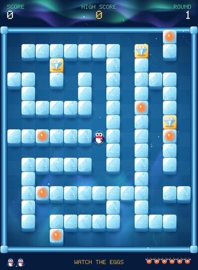</a><br><b>Round 1</b><br>6 Sno-Bees</td>
    <td align="center"><a href="docs/screenshots/rounds/round-02.png">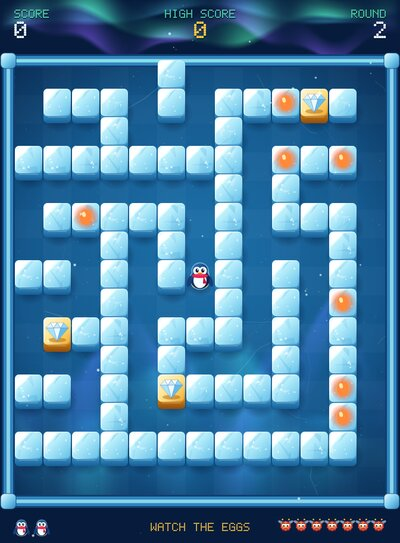</a><br><b>Round 2</b><br>7 Sno-Bees</td>
    <td align="center"><a href="docs/screenshots/rounds/round-03.png">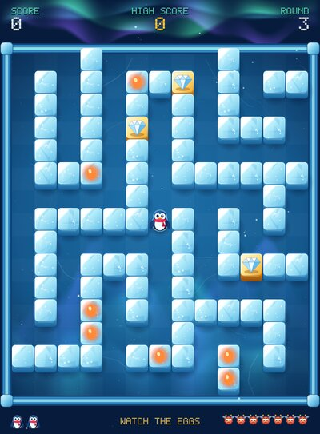</a><br><b>Round 3</b><br>7 Sno-Bees</td>
    <td align="center"><a href="docs/screenshots/rounds/round-04.png">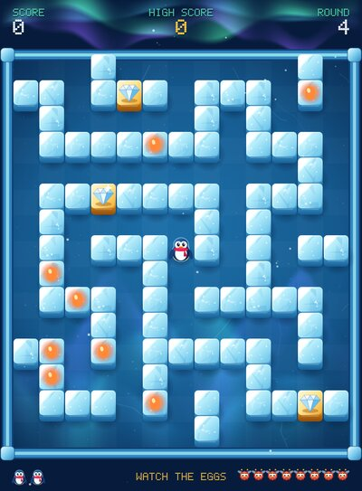</a><br><b>Round 4</b><br>8 Sno-Bees</td>
  </tr>
  <tr>
    <td align="center"><a href="docs/screenshots/rounds/round-05.png">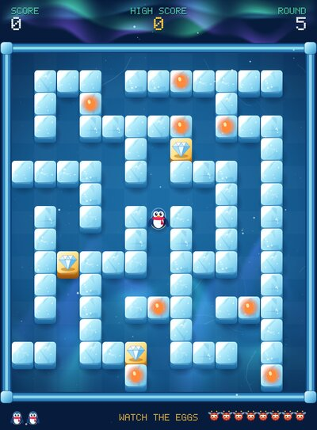</a><br><b>Round 5</b><br>8 Sno-Bees</td>
    <td align="center"><a href="docs/screenshots/rounds/round-06.png">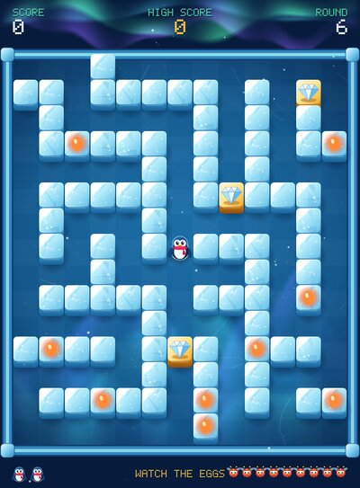</a><br><b>Round 6</b><br>9 Sno-Bees</td>
    <td align="center"><a href="docs/screenshots/rounds/round-07.png">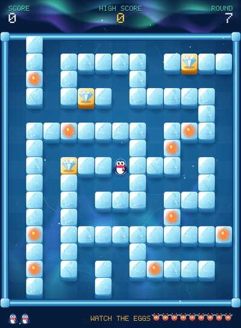</a><br><b>Round 7</b><br>9 Sno-Bees</td>
    <td align="center"><a href="docs/screenshots/rounds/round-08.png">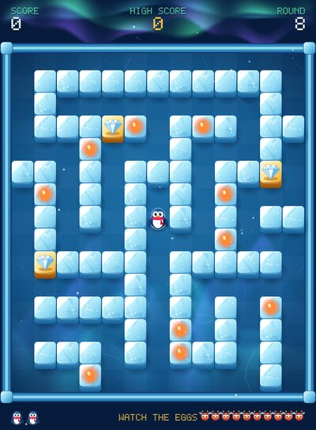</a><br><b>Round 8</b><br>10 Sno-Bees</td>
  </tr>
  <tr>
    <td align="center"><a href="docs/screenshots/rounds/round-09.png">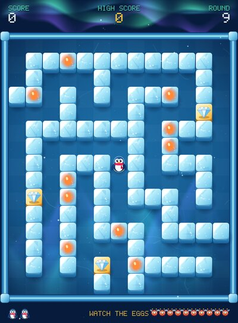</a><br><b>Round 9</b><br>10 Sno-Bees</td>
    <td align="center"><a href="docs/screenshots/rounds/round-10.png">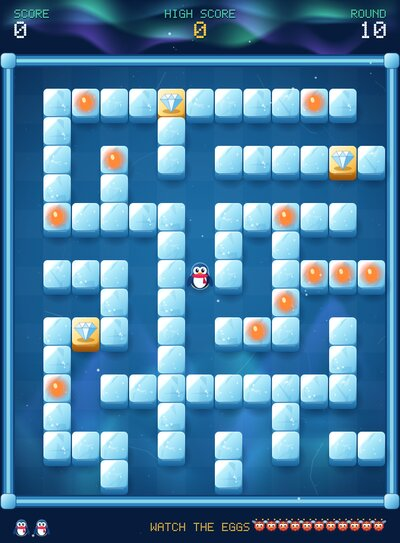</a><br><b>Round 10</b><br>11 Sno-Bees</td>
    <td align="center"><a href="docs/screenshots/rounds/round-11.png">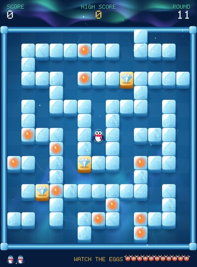</a><br><b>Round 11</b><br>11 Sno-Bees</td>
    <td align="center"><a href="docs/screenshots/rounds/round-12.png">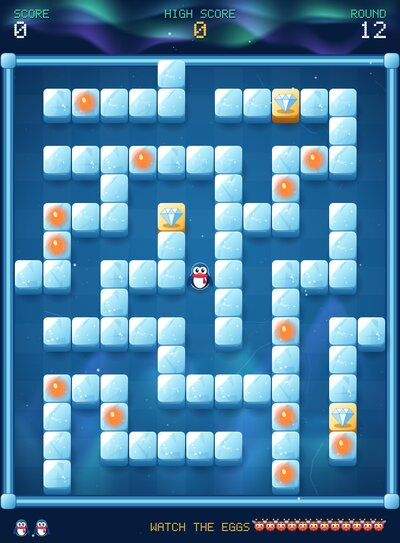</a><br><b>Round 12</b><br>12 Sno-Bees</td>
  </tr>
</table>

## Development

The game is plain JavaScript and Canvas 2D with no dependencies. All graphics and sound are generated in code.

| File | Purpose |
|---|---|
| `js/core.js` | Game rules and simulation, with no browser code |
| `js/art.js` | All drawing |
| `js/audio.js` | Sound effects and music, synthesized with WebAudio |
| `js/main.js` | Game loop, input and saved settings |

```bash
node --test test/core.test.js          # game rule tests, requires Node.js
node scripts/capture-screenshots.mjs   # regenerates the images in this README
```

The capture script needs Playwright and ImageMagick. Its scenes are set up by script and drawn by the game itself.

## License

The code is released under the [MIT License](LICENSE). This is a fan project, not affiliated with or endorsed by Sega. Pengo is the name of the original arcade game, and the license doesn't grant any rights to that name.
